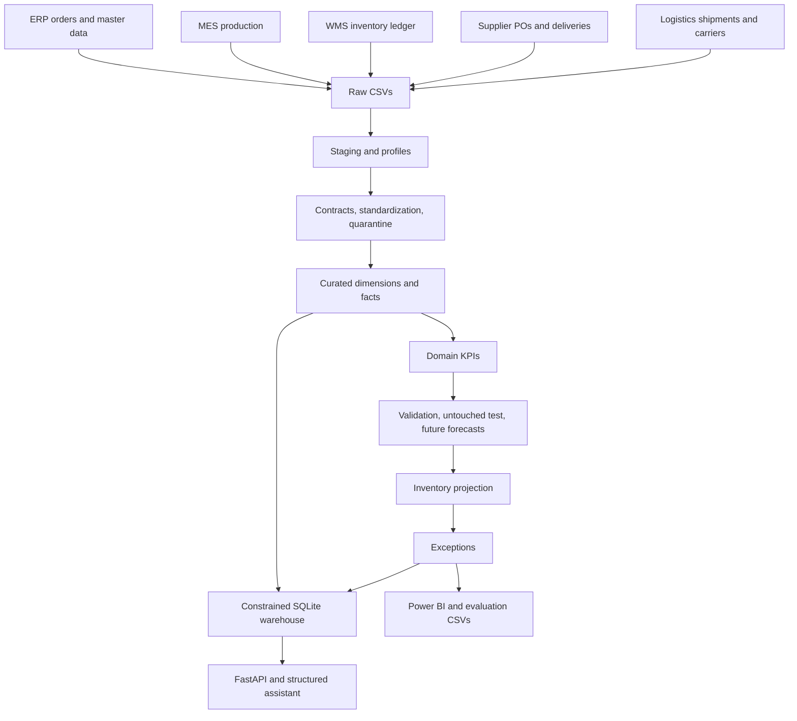

# Architecture

All inputs are fictional PackRight synthetic sources.

| Module | Responsibility |
|---|---|
| `src/config.py` | Portable configuration and artifact directories |
| `src/data/generate.py` | Fixed-seed simulation and defect manifest |
| `src/data/contracts.py` | Keys, required fields, dates, nonnegative numerics and references |
| `src/pipeline/clean.py` | Profiles, quarantine, standardization and star transformation |
| `src/analytics/metrics.py` | Demand, inventory, suppliers, orders, logistics and facilities |
| `src/forecasting/models.py` | Baseline, regression, chronological selection and holdout |
| `src/inventory/project.py` | Quantity balance, crossing dates, replenishment |
| `src/exceptions/engine.py` | Stable IDs, thresholds, severity, recommendations |
| `src/db/warehouse.py` | DDL, checks, indexes, atomic replacement, validation |
| `src/reporting/export.py` | Curated/Power BI CSVs and SHA-256 manifest |
| `src/ai/assistant.py` | Fixed SQL retrieval, fallback, optional provider |
| `src/api/app.py` | Validated requests, safe queries and workflow changes |
| `src/pipeline/run.py` | Complete orchestration and run receipts |
| `scripts/` | HTTP smoke, independent audit and evidence documentation |

Dimensions use stable positive integer simulation keys. `dim_date` has a YYYYMMDD key and unique ISO date; fact date columns reference that date. Sales fact grain is **order line**. One shipment belongs to a line and one delivery to a PO, enforced by unique constraints. The supplier-product bridge defines qualified sources. No direct relationship from fact-to-fact is needed in Power BI.

Quantities are nonnegative. Fulfilled cannot exceed ordered. Inventory has a unique date/product/facility grain and SQL balance constraint. Exceptions have nullable affected-entity IDs and constrained statuses/severities. Aggregate primary keys match their documented grains. Candidate validation and final forecast test tables are separate from operational forecasts.

Staging preserves ingestion. Cleaning quarantines missing keys, invalid references, negatives, duplicates and bad dates rather than inventing repairs; category case/whitespace is standardized. Parent-before-child validation and cardinality-validated joins prevent orphan facts or multiplied demand. The defect manifest and quality report retain lineage.

Loading builds a temporary database, inserts rows in one transaction, validates integrity and foreign keys, closes the connection and replaces the prior warehouse after success. Stable exception IDs recover workflow statuses on reruns. CSV export follows database success and writes hashes. CSV sets are not transactionally published; an interrupted export needs a rerun. The CLI supports serial local execution, not concurrent ingestion. Stop long-running database clients for Windows replacement if necessary.

SQLite removes cloud requirements. Pandas keeps ETL explainable; NumPy implements a small auditable forecast; FastAPI supplies validation and OpenAPI. Supplier/logistics calculations are in the shared metrics module instead of empty directories. `database/analytical_queries.sql` provides warehouse analysis examples.

Future production work would require CDC/incremental loading, dimensional history, late facts, BOM conversion, constrained production plans, probabilistic forecasts, authentication, workflow audit history and scheduling. These are not implemented capabilities.
